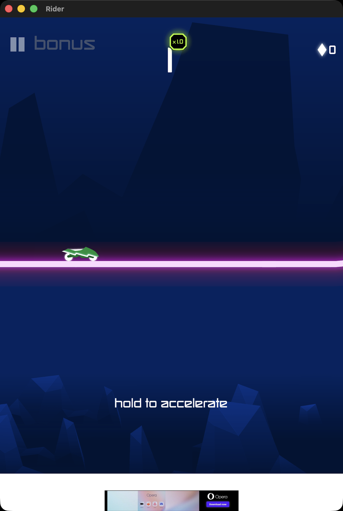
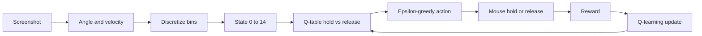

# Rider Q-learning

Tabular Q-learning agent that learns **hold vs release** for [Ketchapp Rider](https://apps.apple.com/app/rider/id1217141858) on Mac. No neural network — just a **15×2** lookup table.



## Requirements

- **Python 3.10+**
- **macOS** for real-game training (Screen Recording + Accessibility for **Terminal.app**)
- Ketchapp **Rider** installed (`/Applications/Rider.app`)
- Mock training works on any OS with Python (no game needed)

## Quick start (mock — no permissions)

```bash
python -m venv .venv
source .venv/bin/activate
pip install -r requirements.txt
python train.py
```

## Mac training (Terminal.app only)

macOS attaches Screen Recording / Accessibility to the **app that owns the process**. Cursor’s integrated terminal counts as Cursor — use **Terminal.app** or iTerm instead.

1. Open Rider and leave the window visible.
2. System Settings → Privacy & Security → enable **Screen Recording** and **Accessibility** for **Terminal**, then quit and reopen Terminal.
3. Train:

```bash
cd ~/Desktop/rider-qlearning   # or your clone path
source .venv/bin/activate
pip install -r requirements.txt
python capture_test.py         # optional smoke test
python train_mac.py
```

Resumes from `checkpoints/q_table_mac.npy` when the reward version matches. Delete that file (or let a reward-version bump reset it) to start fresh.

**Kill switches** (any one stops training and releases the mouse):

- Park the cursor in the **top-left corner** (~0.35s)
- Hold **Escape**
- **Ctrl+C**

## What it optimizes

Rider scores **distance** first; **landed** flips add bonus (perfect landings roughly double flip points). Crashing mid-flip ends the run.

Mac rewards mirror that:

| Signal | Reward |
|--------|--------|
| Stay alive / cover ground | `+1` per step |
| Land a flip (inverted → upright) | `+4` |
| Crash / back to menu | `-12` |

Control steps are short (~40ms) so hold/release can stay snappy.

## Architecture



```
train.py                 # mock env trainer (safe, no game)
train_mac.py             # real Rider on Mac
capture_test.py          # screenshot + angle smoke test
play_tap_test.py         # debug Play-button click
pyproject.toml           # package metadata / version
requirements.txt         # pip install -r path
rider_qlearning/
  bins.py                # continuous values → state id
  q_table.py             # 15×2 table + update rule
  agent.py               # epsilon-greedy policy
  mock_env.py            # fake Rider for learning the loop
  mac_window.py          # find window + screenshot
  mac_input.py           # mouse hold / release / tap
  features.py            # angle, Play button, in-run detection
  mac_env.py             # real-game environment + rewards
  safety.py              # kill switches
  step.py                # shared StepResult
```

## Bins

- Angle edges `[-45, -15, 15, 45]` → 5 buckets
- Velocity edges `[-2, 2]` → 3 buckets
- State id = `angle_bin * 3 + velocity_bin` → `0..14`

## Disclaimer

This project is an educational automation demo for personal learning. **Rider** and its art belong to Ketchapp. This repository’s code is MIT-licensed; game assets are not redistributed as a product claim.

## License

[MIT](LICENSE) © Tyler Mestery
